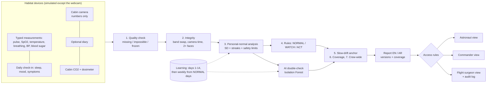

# Architecture

Everything in the diagram runs on one on-board computer with the Python standard library (`run_offline.py`), with no network. The FastAPI backend (`backend/main.py`) has the same API, for development.

| Layer | Code |
|---|---|
| Inputs | `engine/simulate.py` (simulator), `camera/` (real webcam) |
| Quality | `engine/quality.py` |
| Integrity | `engine/integrity.py`, `engine/monitor.py` |
| Analysis | `engine/analysis.py` |
| Rules | `engine/fusion.py` |
| AI | `engine/anomaly.py` |
| Reports | `engine/report.py`, `engine/arabic.py` |
| Access and audit | `engine/access.py` |
| Versions | `engine/version.py` |
| Servers | `run_offline.py`, `backend/main.py` |
| Dashboard | `frontend/` |

Operating concept:
* the **astronaut** opens their own view (What changed, How sure, Do next, When to escalate);
* the **commander** sees the crew's status without private self-report;
* the **flight surgeon** gets the full report at each contact window.

If a sensor fails, the status says so and the report asks for a sensor check. If the whole computer fails, the crew carries on with the normal mission medical procedures: the system is decision support, not a required control.
